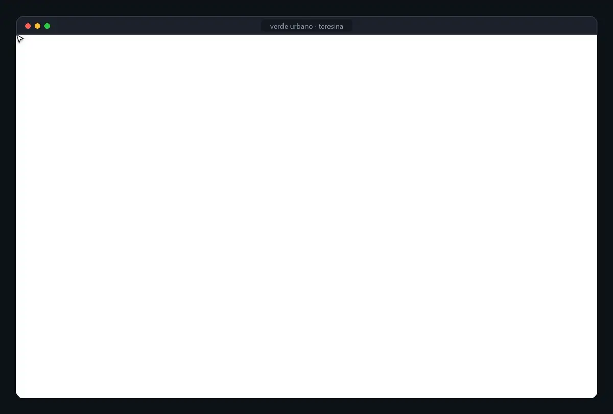
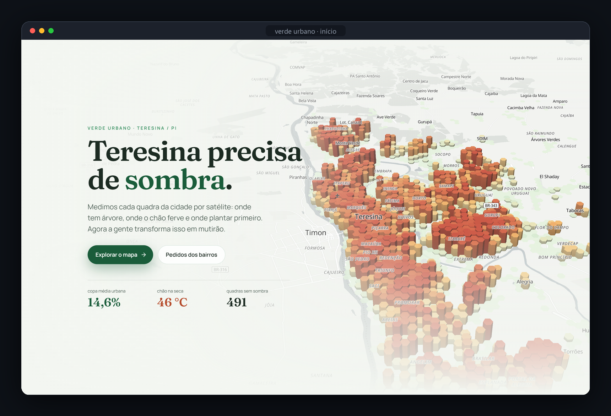
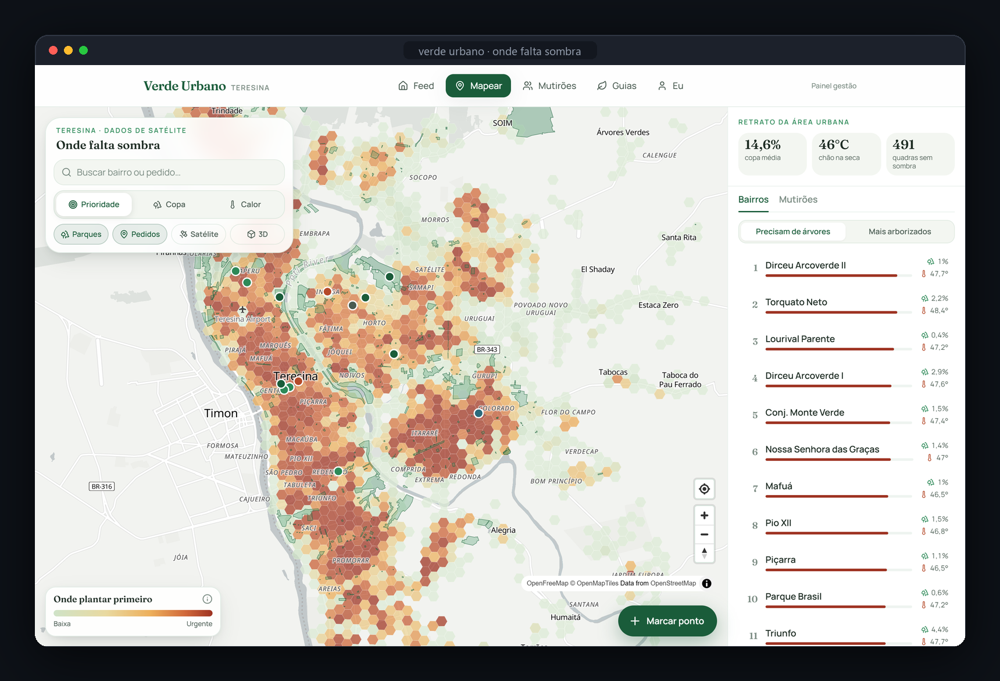
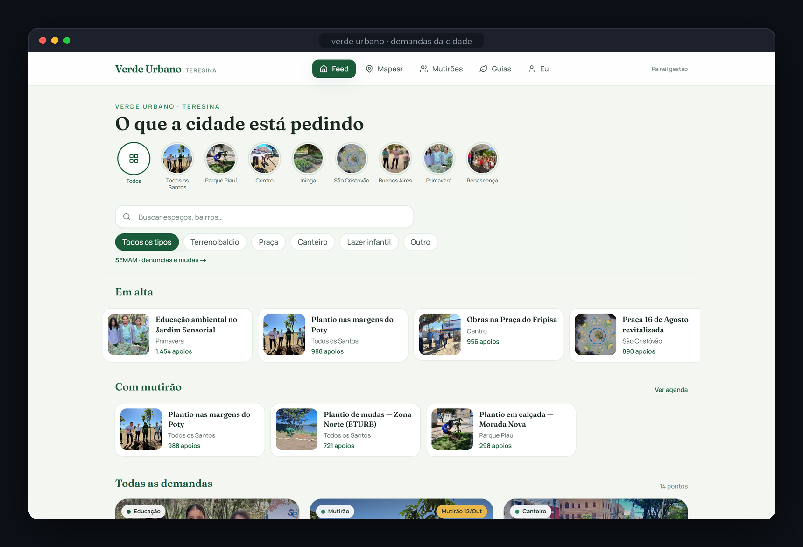
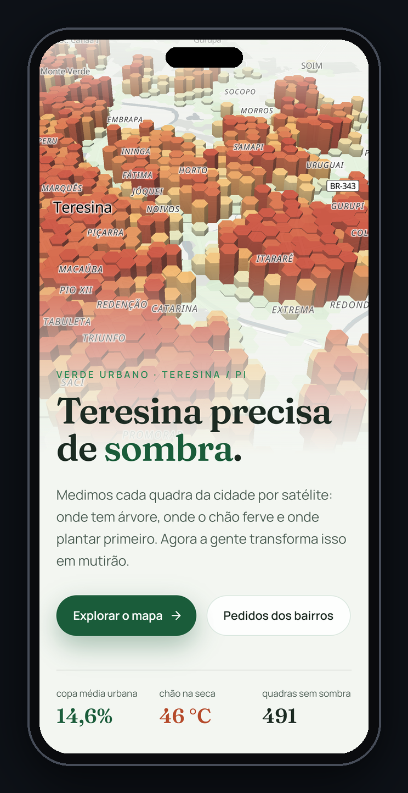
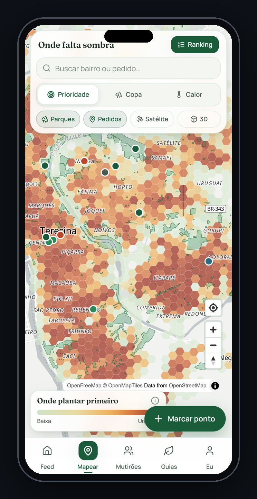
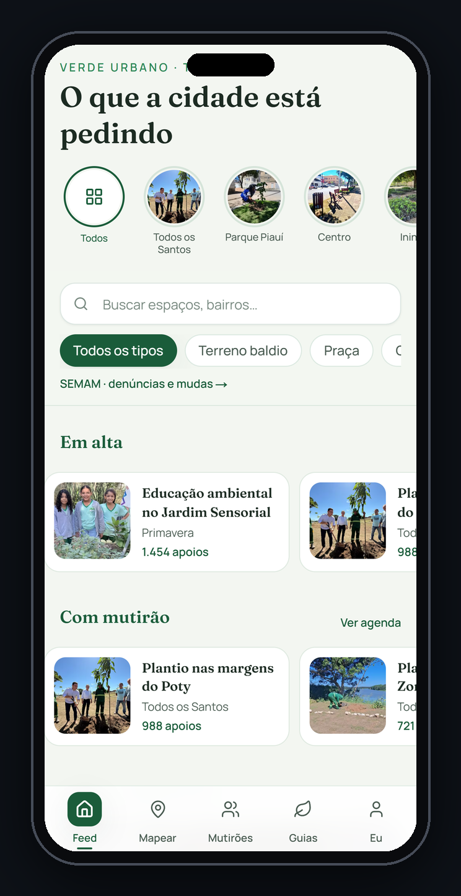

<h1 align="center">Verde Urbano</h1>

<p align="center"><b>Teresina precisa de sombra.</b><br/>
Plataforma colaborativa que mostra, quadra por quadra, onde falta árvore na cidade<br/>
e transforma isso em plantio, mutirão e cobrança aos órgãos certos.</p>

<p align="center">
  
  
  
  
  
</p>

---

## O problema

Teresina é uma das capitais mais quentes do Brasil, e a falta de árvore não é igual em todo lugar: tem bairro com sombra e bairro
onde o chão chega a 46 °C. Sem dado, o plantio vai para onde é mais fácil, e não para onde é mais urgente.

## A solução

O Verde Urbano **mede cada quadra pela imagem de satélite** (onde tem copa, onde o chão esquenta e onde plantar primeiro) e coloca
isso num mapa que qualquer pessoa entende. Em cima do mapa, o cidadão aponta problemas, apoia demandas e se junta a mutirões,
e encontra o órgão certo para pedir muda, poda ou denunciar.

## Telas

<p align="center"></p>
<p align="center">
  
  
</p>
<p align="center">
  
  
  
</p>

## O que tem

| Parte | O que faz |
|---|---|
| **Mapa de calor** | Hexágonos por quadra com camadas de prioridade, copa e calor, busca por bairro e ranking dos bairros que mais precisam |
| **Mapear** | O cidadão marca no mapa onde falta árvore, onde tem muda para plantar ou um espaço para revitalizar |
| **Feed da cidade** | Demandas por tipo (terreno baldio, praça, canteiro), "em alta", apoios e mutirões agendados |
| **Guias e órgãos** | Quem cuida de quê (SEMAM e órgãos parceiros), viveiros, perguntas frequentes e como denunciar |
| **Painel de gestão** | Indicadores, mapa de calor, gráficos e exportação em GeoJSON |

## Como foi feito

`Next.js 14` · `Tailwind` · `MapLibre` · `Recharts` · `TanStack Query` · `Supabase` · `PWA`

Roda **sem custo**: Vercel Hobby, Supabase Free e mapas do OpenFreeMap. Funciona com dados de exemplo mesmo sem banco.

## Como rodar

```bash
npm install
npm run dev
```

| Página | Endereço |
|---|---|
| Capa | `http://localhost:3000` |
| Mapa | `/mapear` |
| Feed | `/feed` |
| Guias | `/guias` |
| Painel | `/gestao` |

<sub>Conteúdo institucional baseado nas páginas públicas da SEMAM e da Prefeitura de Teresina. As fotos do feed são públicas, do portal da Prefeitura.</sub>

---

<p align="center">Projeto de extensão universitária · feito por <a href="https://github.com/ymedeiros228"><b>Yuri Medeiros</b></a> · <a href="https://www.linkedin.com/in/yuri-medeiros-1071533b4/">LinkedIn</a></p>
